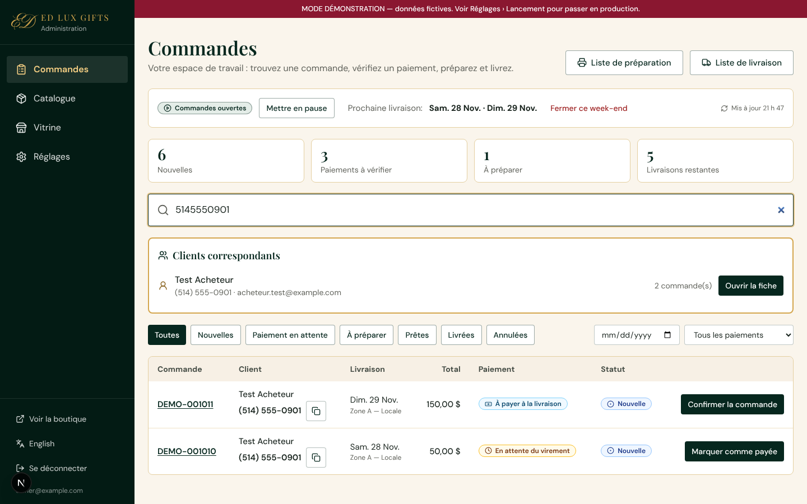
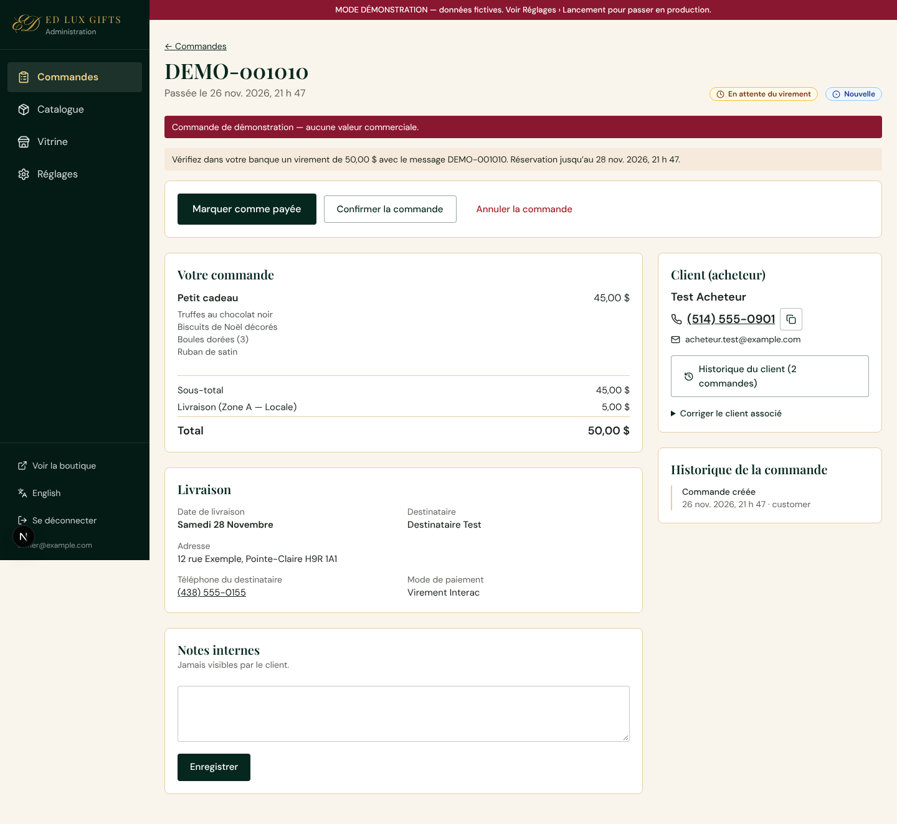
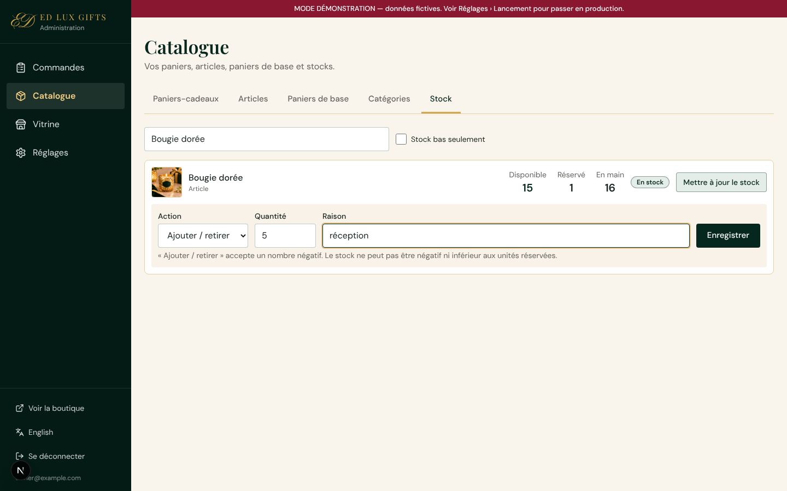
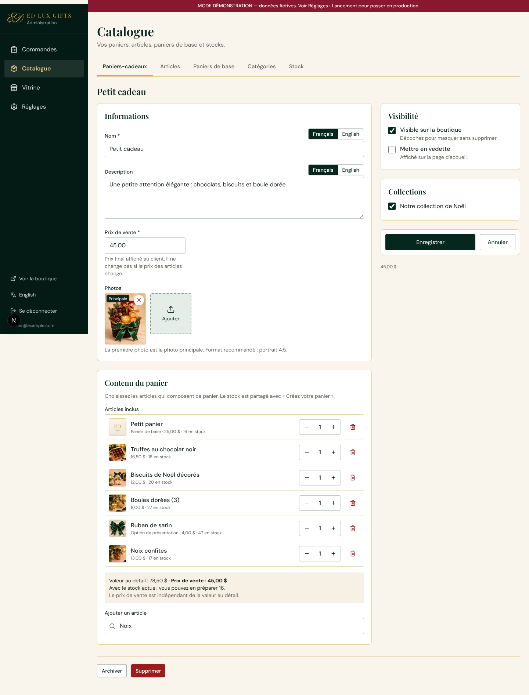
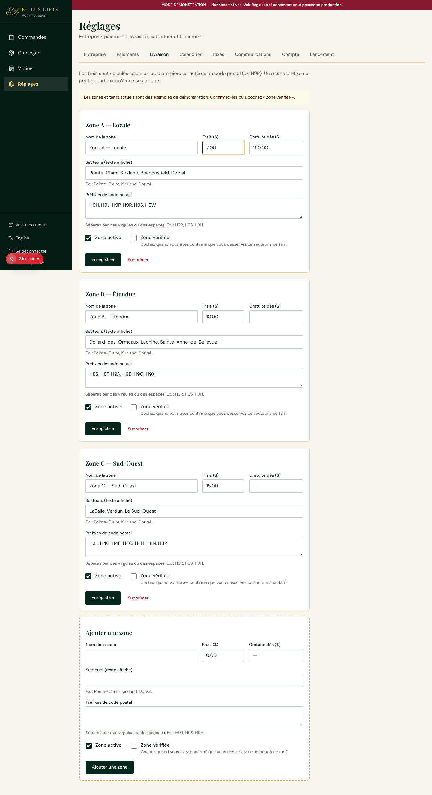
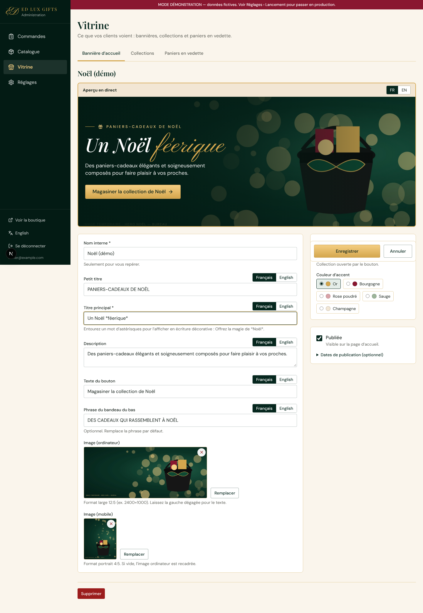

# Owner guide (plain language)

The admin has four sections: **Commandes** (orders), **Catalogue**, **Vitrine** (what customers see) and **Réglages** (settings). After login you land on Orders. You can switch FR/EN at the bottom of the sidebar (top right on a phone). On a phone, the four sections are the tabs along the bottom.

## When a customer calls
Type their phone number (any format, even just the last digits) in the big search box on **Commandes**. The matching customer appears at the top — tap **Ouvrir la fiche** to see all their orders, call or copy their number. You can also search by name, email or order number, across all dates.

## Verify an Interac payment
Orders waiting for a transfer show **Marquer comme payée**. Check your bank for the amount with the order number in the message, then click it. This also confirms the order. If the customer paid late and the order shows "Paiement expiré", open it and use **Réactiver (virement tardif)**, then mark it paid (if the items were sold meanwhile you will be told).

## Prepare and deliver
Each order has one main button that moves it forward: Confirmer → Commencer la préparation → Prête à livrer → Marquer livrée (for cash on delivery: **Livrée et payée**). Print the **Liste de préparation** (baskets with their contents, ticked boxes) and the **Liste de livraison** (by day and zone, with phone numbers, instructions and amounts to collect). Cancelling asks for confirmation and returns the stock.

## Update inventory
**Catalogue › Stock**: search an item, click **Mettre à jour le stock**, choose "Ajouter / retirer" (use a negative number to remove) or "Fixer la quantité", add a reason, save. Stock can't go negative or below what's reserved for open orders. Low-stock items show a warning.

## Change a price, add a photo, create a basket
- **Price/photo of an item**: Catalogue › Articles › click the item › change the price or "Remplacer" the photo › Enregistrer.
- **New gift basket**: Catalogue › Paniers-cadeaux › *Ajouter un panier-cadeau*. Fill the name and description (tabs Français/English), the selling price (independent of item prices), photos, then search items to add them to the contents — no codes to type. The page tells you how many you can make with current stock.
- **Basket bases & "Créez votre panier"**: *Paniers de base* hold price, space (capacity) and included finishing touches; each item has "space used". Categories group items for customers.

## Change a delivery fee / close a weekend
- **Réglages › Livraison**: each zone has a fee, optional free-delivery threshold and postal-code prefixes (e.g. H9R). The new fee applies to new orders only.
- **Close the current weekend**: button at the top of Commandes (or Réglages › Calendrier for any weekend). **Mettre en pause** stops all new orders but customers can still track theirs.

## Replace the homepage banner / add a new season
**Vitrine › Bannière d'accueil**: edit the text (wrap a word in `*stars*` for the script font), upload the desktop and mobile images, choose the destination collection and an accent colour, preview live, then publish (optionally with start/end dates). To add a new occasion: **Vitrine › Collections › Ajouter**, assign baskets, then create/publish a banner pointing to it. Empty or inactive collections hide themselves; with no banner published a neutral one is shown.

## Before you go live
**Réglages › Lancement** shows the checklist (business info, real Interac address, verified delivery zones, schedule, catalog, taxes, banner, email, test order). Demo data can be cleaned up there safely — only untouched demo items are removed. Taxes: confirm your obligations with your accountant first.
